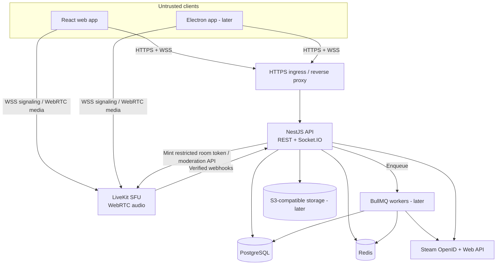
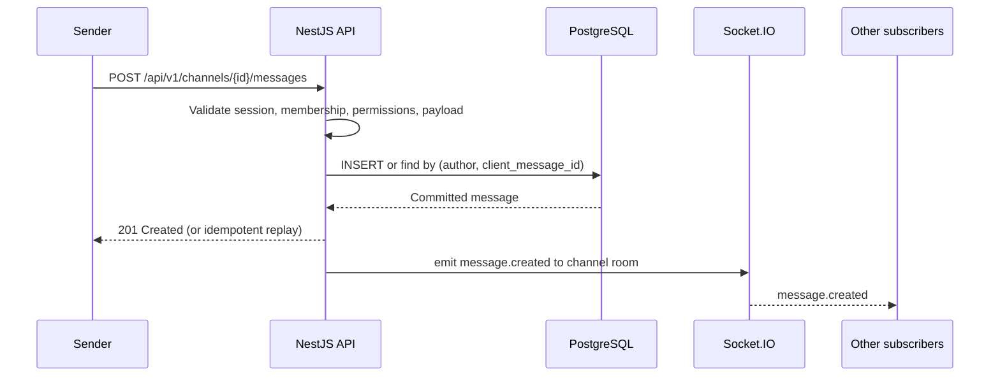
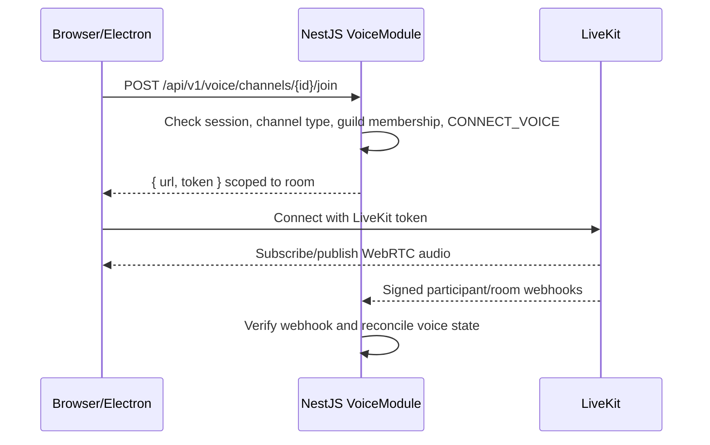
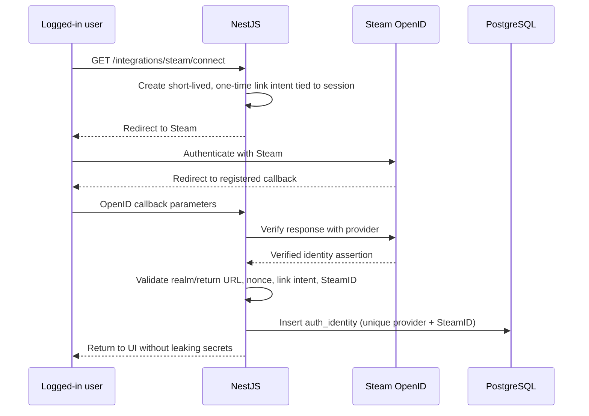

# Guildcore — System Architecture

> **Status:** Proposed architecture (MVP baseline)  
> **Last reviewed:** 2026-11-23  
> **Primary audience:** Backend, frontend, infrastructure, and future desktop contributors  
> **Companion document:** [GUIDE.md](./GUIDE.md)

## 1. Executive summary

The product is a gaming-oriented community platform inspired by Discord. Its initial delivery target is the **web**, followed by a **desktop client built with Electron**. The first meaningful release supports accounts, community servers (called *guilds* in the code), text and voice channels, real-time messaging, and linking a Steam account.

**Core architectural choice: a modular monolith in NestJS.** Business capabilities live in separately owned modules in one deployable API. PostgreSQL is the source of truth for durable application data, Socket.IO distributes ephemeral real-time events, and LiveKit handles voice transport over WebRTC. Redis is introduced for ephemeral state and jobs when a concrete use case needs it. This keeps initial development operationally simple while allowing targeted scaling later.

The backend is shared by the browser and future Electron clients: **there is no separate desktop backend**.

### 1.1 Goals

- Reliable text communication in channels and direct messages.
- Low-latency group voice communication without implementing an SFU from scratch.
- First-class community membership, roles, and permissions.
- Secure local authentication and voluntary connection of a Steam identity.
- Well-defined, versioned HTTP and real-time contracts consumed by multiple clients.
- A predictable local setup, reproducible migrations, effective tests, and an incremental deployment path.
- Extensibility for game profiles, Looking For Group (LFG), shared libraries, events, and future integrations.

### 1.2 Non-goals for the first release

- Microservices, Kafka, Kubernetes, event sourcing, or global multi-region infrastructure.
- Video, screen sharing, call recording, or gameplay overlays.
- End-to-end encrypted group messaging or calling (not provided by this design).
- Offline-first full message synchronization, advanced search, or complex content moderation tooling.
- Deep Steam integration that bypasses Steam privacy settings or relies on undocumented APIs.

### 1.3 Assumptions and explicit decisions

- **Language:** TypeScript throughout the server and (eventually) clients.
- **Deployment:** one API instance for the initial release; scale out only as load requires.
- **Voice:** LiveKit for media and presence inside voice rooms; NestJS controls admission and authorization.
- **Chat:** HTTP for commands and history, Socket.IO for push updates. A future WebSocket command API is possible without rewriting message services.
- **Authentication:** opaque server-side sessions in `HttpOnly` cookies for the browser; a separate secure native login strategy will be designed when Electron is built.
- **Naming:** user-facing “servers” are represented by `guilds` to avoid confusing them with infrastructure servers.
- **Files:** object storage for attachments; the database stores metadata and access controls, not file blobs.

---

## 2. Technology choices

| Concern | Choice | Rationale / adoption |
| --- | --- | --- |
| HTTP backend | NestJS on Node.js / TypeScript | Structured modules, DI, guards, pipes, testing; MVP |
| HTTP API | REST, `/api/v1` | Simple resources, HTTP semantics, OpenAPI; MVP |
| Real-time signaling | Socket.IO | Rooms, reconnect support, events; MVP |
| Voice transport | LiveKit + WebRTC (SFU) | Low-latency audio fan-out; MVP |
| Database | PostgreSQL | Transactions, relational constraints, robust querying; MVP |
| ORM | TypeORM | Fits the preferred stack; explicit migrations; MVP |
| Session store / ephemeral state | Redis | Shared session/presence state, rate limits as needed; MVP infrastructure |
| Background work | BullMQ with Redis | Steam synchronization, retries, maintenance; add in Steam milestone |
| Steam authentication | Steam OpenID 2.0 | Obtains and verifies SteamID64; Steam milestone |
| Steam profile | Steam Web API | Public/authorized data only, subject to privacy and API rules |
| Object storage | S3-compatible storage | Attachments, avatars; when attachments ship |
| Documentation | OpenAPI/Swagger + typed event contracts | Stable client integration; MVP |
| Repository | pnpm workspaces | Shared contracts and build tooling; MVP |
| Infrastructure | Docker Compose (local), reverse proxy + managed services (production) | Minimal operational burden |
| Frontend | React, later Electron shell | Same backend; clients added after backend foundation |
| Testing | Jest + Supertest, integration tests using PostgreSQL | Fast feedback with realistic persistence |

**Not chosen initially:** GraphQL, a document database for messages, independent auth/chat services, or a custom WebRTC infrastructure. Revisit only if a measured requirement justifies the complexity.

---

## 3. System context and trust boundaries



This is a **logical** diagram, not a literal network topology. LiveKit's media route, TURN connectivity, ingress, and firewall rules are configured separately from NestJS. In production, HTTP signaling and public WebRTC connectivity must use the endpoints expected by the LiveKit deployment.

**Trust boundary:** every request or event arriving from either client is untrusted. Session validation, resource authorization, validation, abuse controls, and server-side ownership decisions always run on the backend. Neither a channel ID nor a Socket.IO room name grants access by itself.

### 3.1 Responsibilities

| Component | Owns | Must not own |
| --- | --- | --- |
| NestJS | Business rules, authentication, permissions, message persistence, Steam linking, LiveKit grants | Raw audio forwarding |
| PostgreSQL | Users, memberships, channels, roles, messages, sessions, integration records | Online/presence heartbeat timestamps as a high-frequency event stream |
| Socket.IO | Notification fan-out, typing, transient presence and UI updates | Permanent message storage or guaranteed durable delivery |
| LiveKit | Voice room media, connected participants, audio permissions | Community membership or business entitlements |
| Redis | Transient presence, optional shared session storage, queues and inter-instance communication | Primary message history |
| Worker | Retryable, idempotent noninteractive tasks | Access-control decisions based only on job input |
| Steam | External identity and eligible profile/game data | Internal user authorization |

---

## 4. Repository and module organization

```text
guildcore/
├── apps/
│   ├── api/                         # NestJS; implemented first
│   │   ├── src/
│   │   │   ├── main.ts
│   │   │   ├── app.module.ts
│   │   │   ├── config/
│   │   │   ├── database/
│   │   │   │   ├── data-source.ts
│   │   │   │   └── migrations/
│   │   │   ├── common/              # Cross-cutting primitives only
│   │   │   │   ├── decorators/
│   │   │   │   ├── filters/
│   │   │   │   ├── guards/
│   │   │   │   └── interceptors/
│   │   │   ├── infrastructure/
│   │   │   │   ├── cache/
│   │   │   │   ├── queue/
│   │   │   │   ├── realtime/
│   │   │   │   └── storage/
│   │   │   └── modules/
│   │   │       ├── auth/
│   │   │       ├── users/
│   │   │       ├── guilds/
│   │   │       ├── channels/
│   │   │       ├── messages/
│   │   │       ├── voice/
│   │   │       ├── presence/
│   │   │       ├── integrations/
│   │   │       │   └── steam/
│   │   │       ├── notifications/
│   │   │       └── attachments/
│   │   ├── test/
│   │   └── .env.example
│   ├── web/                         # React; later
│   └── desktop/                     # Electron; later
├── packages/
│   ├── contracts/                   # Safe public DTO/event schemas
│   └── config/                      # Shared TS/lint tooling
├── infra/
│   ├── compose.yaml
│   └── docker/
├── .github/workflows/
├── pnpm-workspace.yaml
├── package.json
├── ARCHITECTURE.md
└── GUIDE.md
```

### 4.1 Module ownership

| Module | Main responsibilities | Critical dependencies |
| --- | --- | --- |
| `AuthModule` | Registration, login, logout, password hashes, server-side sessions, Steam account-linking intent | Users, identity storage |
| `UsersModule` | Profiles, preferences, safe public representation | Database |
| `GuildsModule` | Guilds, membership, invites, roles, permission composition | Users |
| `ChannelsModule` | Text/voice/DM channel lifecycle, channel membership, overrides | Guilds |
| `MessagesModule` | Message commands, history, edits, deletes, ordering, deduplication | Channels, authorization |
| `VoiceModule` | Room admission, short-lived grants, moderation and LiveKit webhook reconciliation | Channels, LiveKit |
| `PresenceModule` | Online/idle/offline, last activity, multi-device sessions, typing TTL | Redis, Socket.IO |
| `IntegrationsModule` | Common integration orchestration and external account model | Auth, Users |
| `SteamModule` | OpenID verification, public Steam profile sync, provider-specific errors | Steam API, queue |
| `NotificationsModule` | Mentions, unread bookkeeping, notifications | Messages, users |
| `AttachmentsModule` | Upload authorizations, metadata, retrieval and cleanup | Channels, object storage |

**Module rules:**

1. Controllers and gateways call application services; neither owns business logic.
2. Services own use cases, permissions checks, and transactions; repositories encapsulate persistence queries.
3. A feature module exports **narrow service interfaces**, not every repository/entity.
4. Infrastructure implementations (Redis, LiveKit, Steam HTTP client, storage SDK) are injected behind abstractions where substitutability is useful.
5. `packages/contracts` contains public DTOs and event types; **never** share TypeORM entities or secrets with clients.
6. Keep modules simple initially. Introduce explicit `domain/application/infrastructure` sublayers within a feature only when complexity warrants them.

Example module:

```text
modules/messages/
├── dto/
│   ├── create-message.dto.ts
│   └── update-message.dto.ts
├── entities/message.entity.ts
├── messages.controller.ts
├── messages.gateway.ts
├── messages.repository.ts
├── messages.service.ts
└── messages.module.ts
```

---

## 5. Data model

All primary keys are UUIDs unless explicitly stated. Use `timestamptz` for timestamps, UTC on the wire (ISO 8601), database-level foreign keys, and application-validated inputs. The following is a **target logical schema**, not a claim that these migrations already exist.

### 5.1 Authentication and identities

| Table | Key columns | Constraints / purpose |
| --- | --- | --- |
| `users` | `id`, `username`, `display_name`, `avatar_url`, `created_at`, `updated_at` | Unique normalized username; no provider-dependent primary key |
| `auth_credentials` | `user_id`, `password_hash`, `updated_at` | Only for local password authentication; Argon2id hash |
| `auth_identities` | `id`, `user_id`, `provider`, `provider_user_id`, `created_at` | Unique `(provider, provider_user_id)`; links external identities |
| `sessions` | `id`/`session_hash`, `user_id`, `created_at`, `expires_at`, `revoked_at`, `last_seen_at` | Persist opaque-session state; no raw session tokens stored |
| `steam_profiles` | `user_id`, `steam_id`, `persona_name`, `avatar_url`, `profile_url`, `visibility_state`, `last_synced_at` | Optional sync cache; a SteamID64 is a **string** |

**Session design:** generate a cryptographically random, opaque session secret; send it in a secure cookie; store only a derived hash server-side. Rotate on login/privilege change and invalidate on logout. Keep session storage and renewal policy configurable; a shared Redis-backed session implementation is an alternative to database sessions after its persistence and revocation behavior are reviewed.

### 5.2 Guilds, roles, channels

| Table | Key columns | Notes |
| --- | --- | --- |
| `guilds` | `id`, `name`, `description`, `icon_url`, `owner_id`, timestamps | Community server |
| `guild_members` | `guild_id`, `user_id`, `joined_at`, `nickname` | Composite key `(guild_id, user_id)` |
| `roles` | `id`, `guild_id`, `name`, `permissions`, `position`, `is_default` | Permissions are a bitset. `UNIQUE (id, guild_id)` supports cross-guild assignment checks |
| `member_roles` | `guild_id`, `user_id`, `role_id` | Composite foreign keys to `guild_members` and `roles` so a role cannot cross guilds |
| `channel_sections` | `id`, `guild_id`, `name`, `position` | Organizes channels. A section is not a channel and has no other fields |
| `channels` | `id`, `guild_id`, `section_id NULL`, `name`, `type`, `emoji`, `game_tag NULL`, `position`, timestamps | Guild text/voice. `section_id` is null when the channel sits at the guild root |
| `channel_members` | `channel_id`, `user_id`, `joined_at` | Later, for DM/group DM. Not created for guild channels |
| `channel_permission_overrides` | `channel_id`, `subject_type`, `subject_id`, `allow`, `deny` | Later. Guild roles are enough for the current slice |
| `guild_invitations` | `id`, `guild_id`, `created_by`, `token_hash`, `created_at`, `expires_at`, `revoked_at` | Multi-use for 24 hours. Store only the SHA-256 of the token. Any member can create one. The creator or an `ADMINISTRATOR` can revoke it |

Suggested channel types:

```ts
type ChannelType = 'text' | 'voice';
```

DM and group DM types are deferred. Until then every channel has a `guild_id`. A channel may belong to one section in the same guild, or to none. Deleting a section leaves its channels at the guild root.

Guild authorization uses membership and the OR of role bitsets. `ADMINISTRATOR` allows every check, including removing a member once membership management exists. The guild owner cannot be removed. Inviting requires membership only, so every member can invite; there is no invite permission bit. A link is valid for 24 hours, can be accepted by any number of authenticated non-members until it expires or is revoked, and joins them with the default Everyone role. Preview and accept of an unknown, expired, or revoked token return `404` and do not reveal the guild. Channel overrides are not evaluated yet. The role bitset can gain an allow/deny layer later. DM authorization will use `channel_members` when those channels exist.

### 5.3 Messages and attachments

| Table | Key columns | Notes |
| --- | --- | --- |
| `messages` | `id`, `channel_id`, `author_id`, `client_message_id`, `content`, `created_at`, `edited_at`, `deleted_at` | Persist before emitting; soft delete as an optional policy |
| `attachments` | `id`, `message_id`, `storage_key`, `file_name`, `mime_type`, `size_bytes`, `created_at` | Keep binary data out of PostgreSQL |
| `read_markers` | `user_id`, `channel_id`, `last_read_message_id` | Can be introduced with unread counts |

Recommended constraints and indexes:

```sql
CREATE UNIQUE INDEX uq_messages_author_client_id
  ON messages (author_id, client_message_id)
  WHERE client_message_id IS NOT NULL;

CREATE INDEX idx_messages_channel_history
  ON messages (channel_id, created_at DESC, id DESC);
```

Use an opaque `client_message_id` (UUID generated by client) to make retrying message creation idempotent. The API must return the original result for a previously accepted ID rather than inserting another message. For pagination, use a compound cursor based on `(created_at, id)` or a per-channel sequence; UUID alone is not a reliable chronological sort key. Define a deterministic tie-breaker and retain stable ordering.

**Deletion and retention:** document whether a delete is a tombstone/soft delete or physical purge, how long records remain, how attachment cleanup works, and what admins may access. Privacy and regulatory requirements must be reviewed before launch.

---

## 6. Authentication, authorization, and permissions

### 6.1 Browser session flow

1. Client submits credentials to a rate-limited `POST /api/v1/auth/login`.
2. Server verifies the Argon2id hash and issues a new opaque session in an `HttpOnly` cookie.
3. Subsequent HTTPS requests carry the cookie; the API resolves the active session to a user.
4. Socket.IO authenticates its **handshake** using the same session mechanism and rechecks authorization for protected subscriptions/commands.
5. Logout revokes the session and disconnects or invalidates associated real-time connections.

In production, cookies should use `Secure`, `HttpOnly`, an appropriate `SameSite` setting, and ideally a `__Host-` name if the deployment topology permits it. Protect state-changing requests against CSRF using an explicit strategy (for example validated CSRF tokens and Origin checks); `SameSite` alone is not a complete solution. CORS must allow only approved origins with credentials.

Electron will require a deliberate system-browser-based login and safe OS-specific credential handling; **do not** copy a browser cookie/localStorage pattern into a privileged renderer without reviewing the threat model.

### 6.2 Permissions policy

Proposed permission vocabulary:

```text
ADMINISTRATOR
MANAGE_GUILD
MANAGE_CHANNELS
VIEW_CHANNEL
SEND_MESSAGES
CONNECT_VOICE
SPEAK_VOICE
```

Creating a guild inserts the owner as a member, an Everyone role (`VIEW_CHANNEL`, `SEND_MESSAGES`, `CONNECT_VOICE`, `SPEAK_VOICE`), and an Administrator role (`ADMINISTRATOR`) assigned to the owner.

Every message write/read, attachment operation, guild membership change, socket subscription, and LiveKit join token request must check the **current** permissions. A missing guild or channel, and a caller who is not a member, returns `404`. A member who lacks the required permission returns `403`. Check again when access is revoked: remove unauthorized sockets from rooms and remove/disconnect LiveKit participants as applicable. A minted LiveKit token should be short-lived, room-scoped, tied to the authenticated user, and **not** used as the platform's primary session credential.

---

## 7. Text chat and real-time event design

### 7.1 Message creation sequence



> Broadcasting after a database commit is sufficient for the first version, but **not** an atomic guarantee between DB and Socket.IO. If losing a published notification after a crash becomes unacceptable, introduce a **transactional outbox** processed by a worker.

The browser can display an optimistic message tagged with its `client_message_id` and reconcile it with the HTTP response/event. Avoid relying on an event to acknowledge persistence.

### 7.2 Event namespace and rooms

Proposed Socket.IO rooms:

```text
user:{userId}        personal events / notifications
channel:{channelId}  authorized message updates
guild:{guildId}     authorized guild-wide events
```

Client subscription calls must pass through an authenticated gateway/service. The server determines which rooms the socket may join. Membership and permissions can change during the connection; revoke access proactively and verify on subsequent operations. Multiple tabs/devices are separate sockets for one user.

Example typed server-to-client events:

```ts
interface ServerToClientEvents {
  'message.created': (event: MessageCreatedEvent) => void;
  'message.updated': (event: MessageUpdatedEvent) => void;
  'message.deleted': (event: MessageDeletedEvent) => void;
  'channel.typing': (event: TypingEvent) => void;
  'user.presence_changed': (event: PresenceEvent) => void;
  'voice.participants_changed': (event: VoiceParticipantsEvent) => void;
}
```

Treat the event payloads as versioned public contracts. Prefer consistent names (`resource.action`) and ISO UTC dates. Do not expose private provider data in broadcasts.

### 7.3 Delivery, reconnects, and ordering

- Socket.IO orders events on a working connection, but **defaults to at-most-once delivery**; it is not a message log.
- Durable messages are stored in PostgreSQL and fetched via **cursor pagination**.
- After reconnect, the client requests missed history using a stored cursor, then reconciles duplicates by message ID.
- Typing and presence are ephemeral: missed events can expire rather than replay.
- If multiple API instances appear, use a compatible Socket.IO adapter and account for HTTP long-polling sticky-session requirements. The classic Redis Pub/Sub adapter does **not** supply Socket.IO connection-state recovery by itself.
- Set sensible message size limits, per-user rate limits, and backpressure behavior. Preserve correct behavior over premature global ordering assumptions.

### 7.4 Recommended HTTP API

| Method | Route | Purpose |
| --- | --- | --- |
| `POST` | `/api/v1/auth/register` | Register |
| `POST` | `/api/v1/auth/login` | Create session |
| `POST` | `/api/v1/auth/logout` | Revoke session |
| `GET` | `/api/v1/users/me` | Current user |
| `PATCH` | `/api/v1/users/me` | Update own profile |
| `POST` | `/api/v1/guilds` | Create guild |
| `GET` | `/api/v1/guilds/:id` | Guild details |
| `POST` | `/api/v1/guilds/:id/channels` | Create guild channel |
| `GET` | `/api/v1/channels/:id/messages?cursor=...&limit=...` | Message history |
| `POST` | `/api/v1/channels/:id/messages` | Create message |
| `PATCH` | `/api/v1/messages/:id` | Edit own/allowed message |
| `DELETE` | `/api/v1/messages/:id` | Delete own/allowed message |
| `POST` | `/api/v1/voice/channels/:id/join` | Issue scoped LiveKit token |
| `GET` | `/api/v1/integrations/steam/connect` | Start authenticated Steam link |
| `GET` | `/api/v1/integrations/steam/callback` | Verify Steam OpenID callback |
| `DELETE` | `/api/v1/integrations/steam` | Unlink Steam |

API contract guidelines: consistent validation errors, correct `401` vs `403` vs `404`, never revealing private channel existence unnecessarily, safe pagination limits, idempotent retries for side-effecting commands when appropriate, request IDs in logs, and OpenAPI schemas for every endpoint. Any new clients may rely on `/api/v1` for an extended period.

---

## 8. Voice architecture

**Separate control plane from media plane.** NestJS determines who may join; LiveKit runs the SFU and streams voice between participants. Do **not** pipe audio through Socket.IO.



A voice channel maps to a LiveKit room such as `voice:{channelId}`. The server issues a short-lived access token with `identity = userId` (or a stable per-user/per-session identifier if multi-device simultaneous entry must be supported), `roomJoin: true`, the exact room name, `canPublish` and `canSubscribe` as dictated by permissions. Explicitly deny data publication if not used.

**Voice lifecycle:**

- Client requests token; NestJS checks current authorization.
- Client joins; LiveKit manages the actual participant connection and WebRTC media.
- Verified LiveKit webhooks and/or participant queries reconcile server-visible occupancy; Socket.IO may push UI updates.
- Local mute/deafen may be client-side; server moderation changes LiveKit participant permissions or disconnects participants.
- When guild/channel access is revoked, disconnect affected participants and prevent new token issuance. A short TTL reduces rejoin risk from previously issued tokens; do not assume TTL alone instantly disconnects an active participant.
- TURN, TLS, UDP/TCP reachability, and bandwidth/capacity testing are mandatory for self-hosted production voice.

MVP: join/leave, microphone mute, deafen, participant listing, permission checks, moderation. Later: volume controls, push-to-talk, video, screen sharing, and recording (only with a specific consent/retention design).

---

## 9. Steam integration

### 9.1 Two distinct capabilities

1. **Steam identity linking** via Steam's **OpenID 2.0** website sign-in flow. This verifies a user's SteamID64; it is **not** a general OAuth permission grant to private profile data.
2. **Steam profile/game data retrieval** via permitted Steam Web API endpoints. Availability depends on API keys, Steam policies, and the user's privacy settings.

### 9.2 Linking flow



Requirements:

- Validate the OpenID response server-side and check the claimed identity and return URL.
- Bind the link operation to the **already authenticated** user using a short-lived one-time state/intent; do not link based on callback query parameters alone.
- Prevent account takeover and duplicate linking through database constraints and explicit conflict handling.
- Store SteamID64 as text; JavaScript `number` cannot safely represent every 64-bit value.
- Never request or store a Steam password.
- Require reauthentication for high-risk unlink/relink operations as appropriate.

### 9.3 Profile synchronization

A worker may refresh public Steam data on demand or at a bounded interval (for example every 15–30 minutes initially, adjusted to actual limits and freshness requirements). The API returns cached information while a refresh is queued. Use rate limiting, timeouts, exponential backoff, jitter, job deduplication, and provider-specific error classification.

Possible fields: persona name, avatar, profile URL, public status, and visible games. **Private games cannot be assumed to be accessible merely because the account is linked.** Provide a graceful “data unavailable/private” UI state. Do not hard-code unsupported external-platform capabilities into the generic provider contract.

Provider design sketch:

```ts
interface GamingProvider {
  getProfile(externalUserId: string): Promise<GamingProfile | null>;
  getGames?(externalUserId: string): Promise<Game[]>;
  getPresence?(externalUserId: string): Promise<GamePresence | null>;
}
```

Providers such as Riot, Epic, or Twitch are **future possibilities**, not promises of equivalent API access.

---

## 10. Presence, notifications, and async work

- **Presence:** presence keys in Redis with TTL and connection heartbeats, aggregated per user across all sockets/devices. Distinguish explicit invisible/away preference from observed connectivity. Treat presence as approximate, not durable truth.
- **Typing:** short TTL events scoped to authorized channels; never persist a typing history.
- **Notifications:** initial channel/user events through Socket.IO; later persist unread/read markers and external notifications as separate concerns.
- **Background jobs:** BullMQ for Steam refresh, attachment cleanup, thumbnails/scans, and maintenance when those features ship. Jobs must be idempotent and recheck authorization/privacy where relevant.
- **Data consistency:** PostgreSQL transactions for multi-table write invariants. Transactional outbox only when the value of reliable downstream event emission outweighs its complexity.

---

## 11. Security, privacy, and abuse prevention

**Minimum requirements before public deployment:**

1. HTTPS/WSS everywhere and secrets managed outside source control.
2. Passwords hashed with Argon2id; session rotation/revocation, CSRF protection, secure cookies, explicit CORS allowlist.
3. Object-level authorization on **every** REST endpoint, socket subscription, LiveKit token issue, and upload/download.
4. Payload validation, size limits, safe rich-text/Markdown rendering, output encoding and content-security policy. Never trust HTML from other users.
5. Login and messaging rate limits; invite/abuse controls; audit logging for privileged moderation and account-link changes.
6. Private guild/channel membership must not leak through presence, error messages, resource identifiers, or unread counts.
7. Validate and authenticate LiveKit webhooks; protect Steam OpenID callback/intent and Steam API credentials.
8. Signed object-storage uploads/downloads, file type/size limits, safe filenames, and malware scanning when attachment support launches.
9. Backup/restore tests and documented retention/deletion obligations before user-data collection at scale.
10. Threat model Electron's privileged process separately. Keep `nodeIntegration` disabled, `contextIsolation` and sandbox enabled where possible, and restrict navigation/external links.

This design provides encryption in transit but **does not claim end-to-end encryption** of chat messages or voice.

---

## 12. Environments, deployment, and scaling

### 12.1 Local development

- Run NestJS directly on the host with watch mode.
- Docker Compose runs PostgreSQL and Redis bound to localhost.
- Run LiveKit locally in `--dev` mode (or an explicitly configured Compose service).
- Keep credentials in ignored `.env` files; commit `.env.example` only.
- Run schema changes with migrations; never rely on `synchronize: true`.

### 12.2 Production MVP

- Reverse proxy handles public HTTPS termination and routes to NestJS.
- PostgreSQL in a managed service if possible; restricted networking, monitored connections, automated backups.
- Redis shared securely if sessions/presence/queues require it.
- Use LiveKit Cloud **or** a carefully configured self-hosted LiveKit node; choose based on operational experience and expected bandwidth.
- An object store is needed once file uploads become available.
- CI runs lint, types, unit tests, DB integration tests, migration checks, and a build; CD applies reviewed migrations and deploys the API with health checks.

### 12.3 Evolution by observed load

| Stage | Reason to change | Candidate change |
| --- | --- | --- |
| A — MVP | Small number of communities | Single modular NestJS process |
| B — API scale-out | HTTP/socket CPU or connection pressure | More stateless API instances; Socket.IO adapter + sticky sessions if long-polling |
| C — async load | Provider requests or heavy jobs compete with API | Dedicated BullMQ workers |
| D — voice scale | SFU bandwidth, geography, or room limits | Scale LiveKit independently |
| E — data scale | Slow queries / large message history | Tune indexes, partitioning, read replicas based on measurements |
| F — service split | Team/deployment boundaries genuinely diverge | Extract specific modules behind clear contracts |

Do not use architectural patterns as a substitute for profiling. Monitor message latency, socket connection count, queue lag, PostgreSQL performance, WebRTC packet loss/jitter, and LiveKit egress bandwidth.

---

## 13. Testing and observability

| Test level | What to verify |
| --- | --- |
| Unit | Permission composition, message validation, Steam link decision rules, pagination cursors |
| Integration | Real PostgreSQL migrations, transactions, unique constraints, auth/session behavior |
| HTTP e2e | Auth, authorized/unauthorized CRUD, idempotent posting, error codes |
| Socket e2e | Authenticated handshake, room authorization, revoked membership, reconnect catch-up |
| LiveKit integration | Room grants, unauthorized join rejection, webhook validation, participant moderation |
| Steam mocked-contract tests | Valid/invalid OpenID responses, duplicates, private profile, API timeouts |
| Load | Message bursts, concurrent sockets, voice bandwidth, DB and queue saturation |

Use structured JSON logging with request/correlation IDs, error monitoring, health/readiness checks, and metrics. Do not log plaintext passwords, session tokens, Steam API keys, raw OpenID assertions, or LiveKit tokens. Include basic tracing only as the number of remote calls makes it useful.

---

## 14. Incremental delivery plan

| Milestone | Deliverables | Exit criteria |
| --- | --- | --- |
| **M1 — Foundation** | Workspace, NestJS, Compose, config validation, PostgreSQL, migration workflow, Swagger, lint/tests | Fresh clone can start API and services with documented steps |
| **M2 — Identity** | Users, credentials, sessions, login/logout, guards | Secure auth flow, session revocation and auth tests pass |
| **M3 — Communities** | Guilds, membership, roles, text/voice channels and permission model | Authorized membership/channel lifecycle works |
| **M4 — Chat** | Message CRUD, cursor history, Socket.IO events, typing/presence | Two clients exchange messages; reconnect catches up without duplicates |
| **M5 — Voice** | LiveKit admission, join/leave, mute/deafen, participant state | Multiple clients speak; revoked users cannot remain/join |
| **M6 — Steam** | OpenID link/unlink, cached public profile, scheduled sync | Secure link and private-profile scenarios tested |
| **M7 — Release** | Security hardening, CI/CD, logs, backups, production deployment | Pilot users can use the entire vertical slice reliably |

A product decision may move Steam immediately after M2, since it is a differentiator, without invalidating the architecture.

---

## 15. Architecture decisions and open questions

### Accepted baseline decisions

- **ADR-001:** Modular monolith before microservices.
- **ADR-002:** PostgreSQL as durable source of truth; Redis is supplementary.
- **ADR-003:** REST commands + Socket.IO notifications for the first chat implementation.
- **ADR-004:** LiveKit handles voice media; NestJS handles authorization and room policy.
- **ADR-005:** Steam OpenID 2.0 for account linking; Steam Web API only for permitted data.
- **ADR-006:** One versioned backend supports both web and desktop clients.
- **ADR-007:** TypeORM schema evolution uses explicit migrations (`synchronize: false`).

### Decisions to settle during implementation

- Whether the application should support **anonymous/guest accounts**, or only registered users.
- Exact session storage, expiry and device-management policy.
- Guild channel permission overrides are deferred. The current slice uses guild roles only.
- Direct and group messages are deferred. The current slice has guild text and voice channels only.
- Message deletion/retention policy and reporting/moderation requirements.
- Hosting region and LiveKit Cloud vs self-hosting.
- Public data disclosure and Steam privacy UX.
- The product's core differentiator: chat-first vs guildcore-first (LFG/library/events).

Record meaningful changes in small ADRs instead of silently drifting from this document.

---

## 16. Official references

- [NestJS documentation](https://docs.nestjs.com/)
- [NestJS — TypeORM](https://docs.nestjs.com/data/typeorm)
- [TypeORM — migrations](https://typeorm.io/docs/migrations/setup/)
- [Socket.IO — delivery guarantees](https://socket.io/docs/v4/delivery-guarantees/)
- [Socket.IO — Redis adapter](https://socket.io/docs/v4/redis-adapter/)
- [LiveKit — authentication grants](https://docs.livekit.io/frontends/reference/tokens-grants/)
- [LiveKit — self-hosting overview](https://docs.livekit.io/transport/self-hosting/)
- [Steamworks — user authentication](https://partner.steamgames.com/doc/features/auth)
- [OWASP — session management](https://cheatsheetseries.owasp.org/cheatsheets/Session_Management_Cheat_Sheet.html)
- [OWASP — CSRF prevention](https://cheatsheetseries.owasp.org/cheatsheets/Cross-Site_Request_Forgery_Prevention_Cheat_Sheet.html)
- [Electron — security recommendations](https://www.electronjs.org/docs/latest/tutorial/security)

For practical commands, code conventions, example configuration, milestone tasks, and definition of done, see **[GUIDE.md](./GUIDE.md)**.
